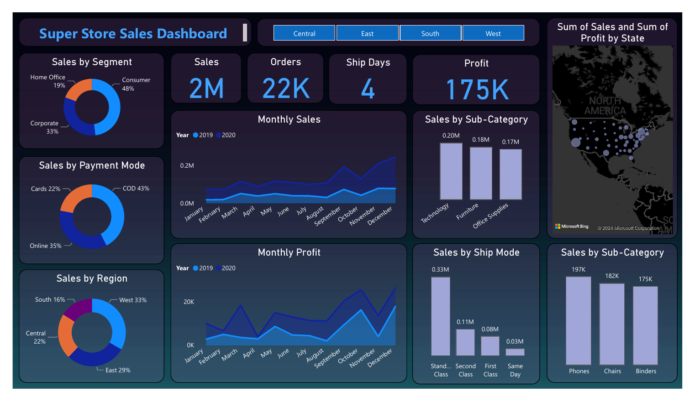
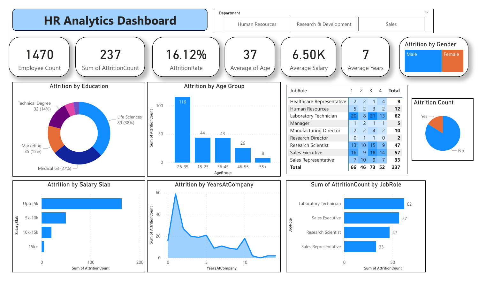
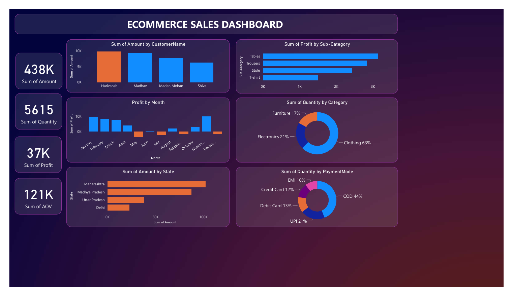
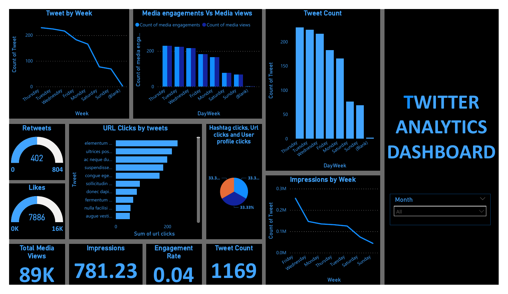

# Power BI Dashboards

Four interactive business intelligence dashboards built in **Microsoft Power BI**, covering sales, e-commerce, HR and social media analytics. Each one turns raw tabular data into KPIs, trends and drill-down views that a manager can use without touching the data.

**Skills shown:** Power BI · data cleaning and modelling · DAX measures · KPI design · time-series trend analysis · slicers and drill-down filters · dashboard storytelling

| Dashboard | Business question | Headline KPIs |
|---|---|---|
| [Superstore Sales](#1-superstore-sales-dashboard) | Where do sales and profit come from? | 2M sales · 22K orders · 175K profit |
| [HR Analytics](#2-hr-analytics-dashboard) | Who leaves the company, and why? | 1,470 employees · 237 leavers · 16.12% attrition |
| [E-commerce Sales](#3-e-commerce-sales-dashboard) | Which customers, products and states drive revenue? | 438K revenue · 37K profit · 5,615 units |
| [Twitter Analytics](#4-twitter-analytics-dashboard) | When and how does content engage users? | 1,169 tweets · 89K media views · 781K impressions |

---

## 1. Superstore Sales Dashboard

**Goal:** give a regional manager a single view of sales, profit and fulfilment across 2019–2020.

- KPI cards for total sales (2M), orders (22K), average ship days (4) and profit (175K)
- Month-by-month sales and profit, comparing 2019 with 2020 to show seasonality and a strong Q4 peak
- Sales split by customer segment (Consumer 48%), payment mode (COD 43%), region (West 33%) and ship mode
- Top sub-categories (Phones, Chairs, Binders) and a state-level sales and profit map
- Region slicer (Central, East, South, West) filters every visual at once

📄 [Open the dashboard (PDF)](Super%20store%20sales%20dashboard.pdf)

## 2. HR Analytics Dashboard

**Goal:** help HR understand the drivers of employee attrition.

- KPI cards: 1,470 employees, 237 leavers, 16.12% attrition rate, average age 37, average tenure 7 years
- Attrition broken down by age group, education field, salary slab, years at company, job role and gender
- **Key findings:**
  - The 26–35 age group accounts for 116 of the 237 leavers.
  - Most leavers earn up to 5K.
  - Attrition peaks in the first one to two years at the company.
  - Laboratory Technicians (62) and Sales Executives (57) have the highest attrition.
- Department slicer (HR, R&D, Sales) for team-level analysis

📄 [Open the dashboard (PDF)](HR%20Analytics%20Dashboard.pdf)

## 3. E-commerce Sales Dashboard

**Goal:** track revenue, profit and customer behaviour for an Indian online retailer.

- KPI cards for revenue (438K), quantity sold (5,615), profit (37K) and average order value
- Monthly profit trend, showing **loss-making months from May to September**
- Revenue by top customers and by state (Maharashtra leads)
- Product mix: Clothing makes up 63% of units, and Tables are the most profitable sub-category
- Payment preferences: COD 44%, UPI 21%

📄 [Open the dashboard (PDF)](Ecommerce%20Dashboard.pdf)

## 4. Twitter Analytics Dashboard

**Goal:** show when content performs best and which posts drive engagement.

- KPI cards: 1,169 tweets, 89K media views, 781K impressions, engagement rate, retweets and likes
- Tweet volume, impressions and media engagement by day of week. Activity and reach peak midweek and fall away at weekends.
- Top tweets by URL clicks, plus the split between hashtag, URL and profile clicks
- Month slicer for period-by-period comparison

📄 [Open the dashboard (PDF)](Twitter%20Analytics%20dashboard.pdf)

---

### Approach
1. **Data preparation:** cleaned and transformed the raw data, handling blanks, date formats and derived columns such as age group, salary slab and day of week.
2. **Modelling:** built calculated measures for KPIs such as attrition rate, profit and average order value.
3. **Design:** KPI cards at the top, trends in the middle and breakdowns below, with slicers so every visual filters together.

**Author:** [Mihir Barve](https://www.linkedin.com/in/mihir-barve-232930257/) · MSc Data Analytics, Queen Mary University of London
